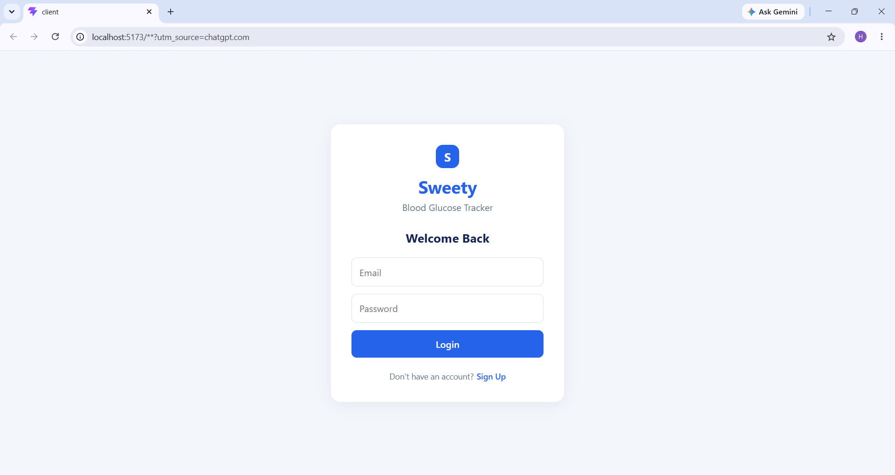
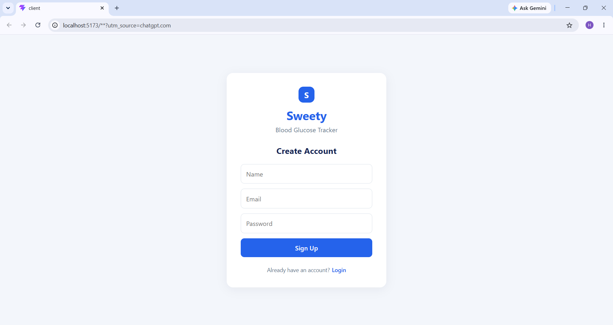
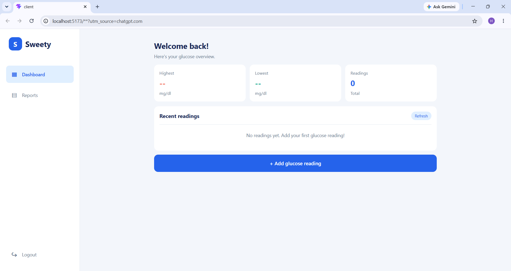
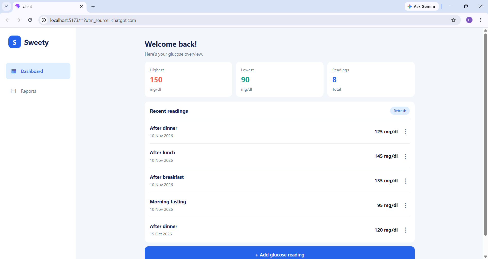
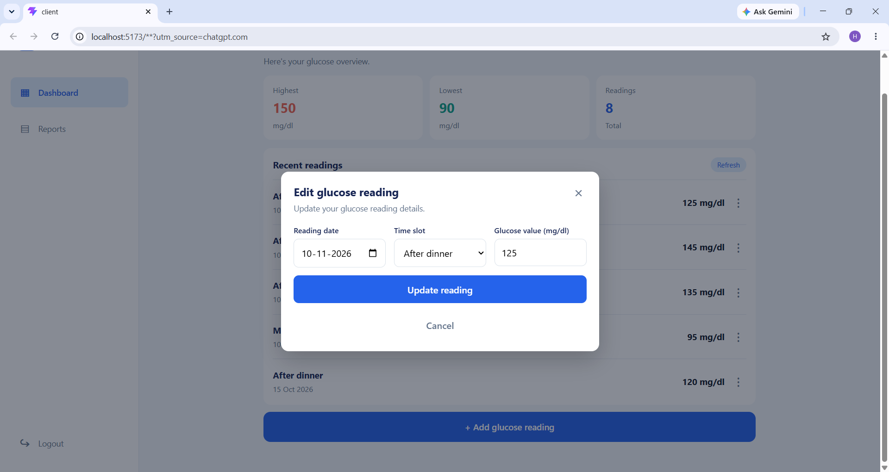
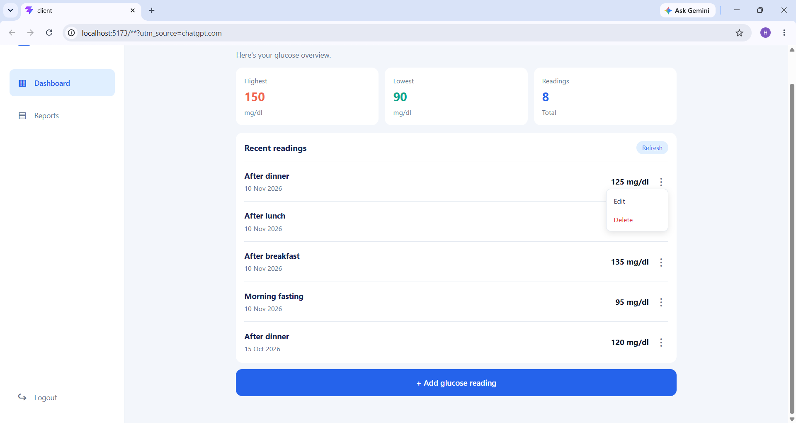
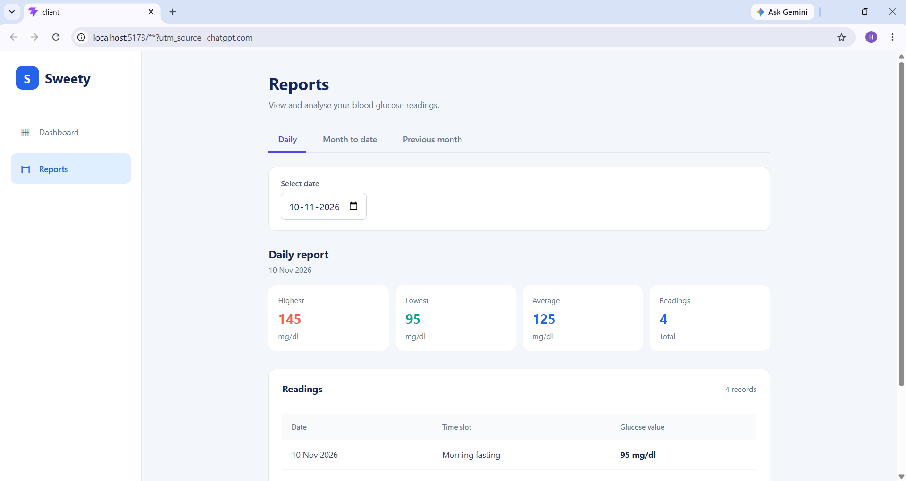
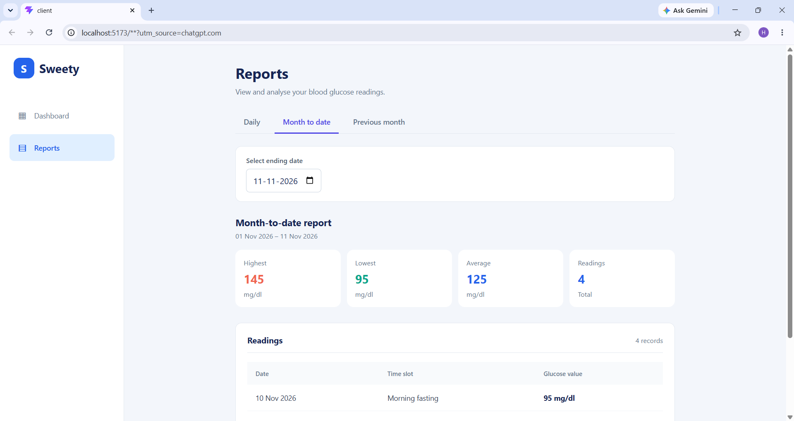
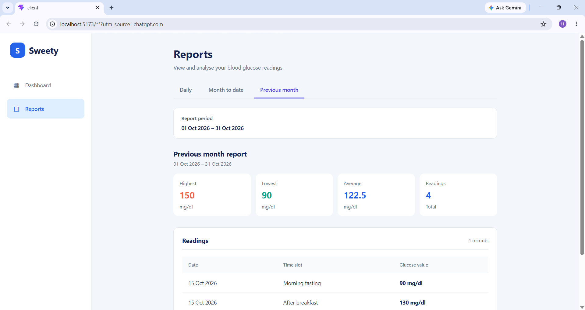

# Sweety – Blood Glucose Tracker

A full-stack web application for tracking and monitoring daily blood glucose readings. Users can securely manage their readings and view daily, month-to-date, and previous-month reports.

## Features

### Authentication

- User registration and login.
- Password hashing using bcrypt.
- JWT-based authentication.
- Protected API endpoints.

### Glucose Reading Management

- Add, view, edit, and delete glucose readings.
- Each reading includes a date, time slot, and glucose value.
- Four available time slots:
  - Morning fasting
  - After breakfast
  - After lunch
  - After dinner
- Users can access only their own readings.

### Reports

- Daily report.
- Month-to-date report.
- Previous-month report.
- Highest, lowest, average, and total number of readings.
- Friendly empty state when no readings are available.

### Validation

- Glucose values must be whole numbers between 40 and 600 mg/dL.
- Duplicate readings for the same date and time slot are not allowed.
- Future reading dates are not allowed.
- Maximum of four readings per day.

## Technology Stack

| Area           | Technologies                   |
| -------------- | ------------------------------ |
| Frontend       | React, CSS, Vite               |
| Backend        | Node.js, Express.js            |
| Database       | PostgreSQL                     |
| Authentication | JWT, bcrypt                    |
| Testing        | Node.js Test Runner, Supertest |

## Project Structure

```text

sweety-glucose-tracker/
│
├── client/                  # React frontend
│   └── src/
│       ├── App.jsx
│       ├── App.css
│       └── main.jsx
│
├── database/
│   ├── schema.sql           # Database table definitions
│   └── seed.js              # Demo user and sample readings
│
├── middleware/
│   └── auth.js              # JWT authentication middleware
│
├── routes/
│   ├── auth.js              # Signup and login routes
│   └── readings.js          # Reading CRUD and report routes
│
├── tests/
│   ├── data/
│   ├── test_db.js
│   ├── readings_post.js
│   ├── readings_get.js
│   ├── readings_put.js
│   ├── readings_delete.js
│   └── readings_reports.js
│
├── screenshots/             # Application screenshots
│
├── .env.example
├── .gitignore
├── db.js
├── server.js
├── package.json
├── package-lock.json
└── README.md
```

## Installation and Setup

### 1. Clone the repository

```bash
git clone https://github.com/HaripriyaShanmugam92/sweety-glucose-tracker.git
cd sweety-glucose-tracker
```

### 2. Install backend dependencies

```bash
npm install
```

### 3. Install frontend dependencies

```bash
cd client
npm install
cd ..
```

### 4. Configure environment variables

Create a `.env` file in the project root using `.env.example` as a reference.

Configure the following variables:

```env
DB_USER=postgres
DB_HOST=localhost
DB_NAME=sweety_glucose_tracker
DB_PASSWORD=your_postgres_password
DB_PORT=5432
JWT_SECRET=your_jwt_secret
TEST_DB_NAME=sweety_glucose_tracker_test
```

Use your own PostgreSQL password and a secure JWT secret.

### 5. Set up the database

Create the development database:

```sql
CREATE DATABASE sweety_glucose_tracker;
```

Create the test database:

```sql
CREATE DATABASE sweety_glucose_tracker_test;
```

Run the database schema:

```bash
psql -U postgres -d sweety_glucose_tracker -f database/schema.sql
```

### 6. Start the backend

From the project root:

```bash
npm start
```

The backend runs at:

`http://localhost:3000`

### 7. Start the frontend

Open a separate terminal:

```bash
cd client
npm run dev
```

Open the local URL displayed by Vite, usually:

`http://localhost:5173`

Keep both frontend and backend servers running while using the application.

## Demo Account

To create a demo user and sample readings, run:

```bash
npm run seed
```

Demo login credentials:

| Field    | Value           |
| -------- | --------------- |
| Email    | demo@sweety.com |
| Password | SweetyDemo@123  |

The seed script creates the demo user with a hashed password and inserts sample glucose readings.

## API Endpoints

### Authentication

| Method | Endpoint           | Description         |
| ------ | ------------------ | ------------------- |
| POST   | `/api/auth/signup` | Register a new user |
| POST   | `/api/auth/login`  | Authenticate a user |

### Glucose Readings

| Method | Endpoint            | Description            |
| ------ | ------------------- | ---------------------- |
| POST   | `/api/readings`     | Add a glucose reading  |
| GET    | `/api/readings`     | Retrieve user readings |
| PUT    | `/api/readings/:id` | Update a reading       |
| DELETE | `/api/readings/:id` | Delete a reading       |

### Reports

| Method | Endpoint                                             | Description           |
| ------ | ---------------------------------------------------- | --------------------- |
| GET    | `/api/readings/report/daily?date=YYYY-MM-DD`         | Daily report          |
| GET    | `/api/readings/report/month-to-date?date=YYYY-MM-DD` | Month-to-date report  |
| GET    | `/api/readings/report/monthly`                       | Previous-month report |

**Authentication:** All glucose reading and report endpoints require a valid JWT Bearer token.

## Running Tests

Run the test suite:

```bash
npm test
```

To run individual test files:

```bash
node --test tests/readings_post.js
node --test tests/readings_get.js
node --test tests/readings_put.js
node --test tests/readings_delete.js
node --test tests/readings_reports.js
```

The tests use a separate PostgreSQL test database configured through `TEST_DB_NAME`.

## Assumptions

- Each user can add one reading per time slot per day.
- A maximum of four readings is allowed per day.
- Glucose values are accepted as whole numbers between 40 and 600 mg/dL.
- Future reading dates are not permitted.
- Users can access and manage only their own readings.
- Reports are calculated using the authenticated user's readings.

## Future Improvements

- Add graphical charts to visualize glucose trends.
- Implement pagination for reading history.
- Add frontend automated tests.
- Improve report filtering and data visualization.

## Screenshots

### Login Page



### Signup Page



### Dashboard - Empty State



### Dashboard - With Readings



### Add Reading


### Edit Reading



### Reading Actions Menu



### Daily Report



### Month-to-Date Report



### Previous Month Report


